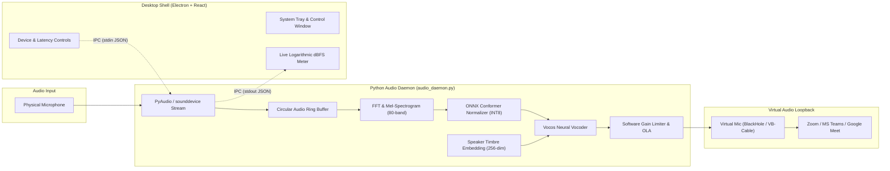

# 🎙️ Resonant AI

> **Edge-Native Real-Time Speech Restoration & Assistive Communication Engine**

[](LICENSE)
[](https://www.electronjs.org/)
[](https://react.dev/)
[](https://www.python.org/)
[](https://onnxruntime.ai/)
[](https://supabase.com/)

---

## 📌 Overview

**Resonant AI** is an edge-native, real-time Speech-to-Speech (S2S) restoration platform engineered to intercept dysarthric or motor-speech impaired audio, normalize acoustic distortions under an ultra-low latency budget (<35 ms), and synthesize fluent speech in the speaker's authentic voice timbre.

By running INT8-quantized neural models locally on consumer hardware, Resonant AI eliminates cloud round-trip delays and safeguards privacy. The processed audio streams directly into virtual loopback microphone drivers (such as **BlackHole** on macOS or **VB-Audio Cable** on Windows), making clean, natural speech available instantly to communication tools like **Zoom**, **Microsoft Teams**, **Google Meet**, and **Discord**.

---

## ✨ Key Features

- **⚡ Sub-35ms Edge Neural Processing**: Runs locally using ONNX Runtime with hardware acceleration (CoreML for Apple Neural Engine, DirectML/CUDA for Windows/Linux).
- **🧠 Conformer Acoustic Normalizer**: Maps dysarthric mel-spectrogram representations to fluent phonetic targets.
- **🗣️ Zero-Shot Authentic Timbre Preservation**: Preserves the speaker’s personal voice identity through a 256-dimensional timbre embedding conditioned into a Vocos neural vocoder.
- **🔄 System-Level Virtual Mic Routing**: Pipes reconstructed speech into standard teleconferencing tools without requiring third-party plugin integrations.
- **🎛️ Minimal Desktop Control Center**: Built with Electron, React, and Tailwind CSS; lives in the system tray and provides real-time logarithmic dBFS input metering, device switching, and latency tuning.
- **🔒 Privacy-First & Edge-Secured**: Raw audio processing is 100% on-device. Supabase integration handles user authentication, encrypted voice embeddings, and opt-in diagnostic telemetry.

---

## 🛠️ Discovered Tech Stack

| Layer | Technologies | Role in Resonant AI |
|---|---|---|
| **Desktop Application** | Electron `^30.0.0`, React `^18.2.0`, Tailwind CSS `^3.4.0` | System tray application, IPC communication, audio device selection UI, live logarithmic dBFS meter |
| **Audio Pipeline & I/O** | Python 3.11+, PyAudio, `sounddevice`, PortAudio, NumPy | Unbuffered background audio streaming daemon, lock-free circular ring buffer |
| **Virtual Audio Drivers** | BlackHole 2ch (macOS) / VB-Audio Virtual Cable (Windows) | System loopback driver exposing Resonant AI as a virtual microphone input |
| **Inference Engine** | ONNX Runtime (`onnxruntime`, `onnx`) | High-performance INT8 hardware-accelerated model execution (CoreML, DirectML, CPU fallback) |
| **Neural Speech Models** | Conformer Encoder, Vocos Vocoder, ResNet / ECAPA-TDNN | Acoustic feature normalization, neural waveform synthesis, and speaker timbre embeddings |
| **Cloud & Database** | Supabase (`@supabase/supabase-js`, PostgreSQL 15, RLS) | User authentication, encrypted voice profile storage, and anonymized session metrics |
| **Build & Tooling** | `esbuild`, PyInstaller, Node.js 20+ | Bundling frontend UI assets and packaging native backend binaries |

---

## 🏛️ System Architecture



---

## 🚀 Local Setup & Installation

### 1. Prerequisites

Ensure your development environment meets the following requirements:

- **Node.js**: v20.x or newer & **npm** v10.x
- **Python**: v3.11.x
- **PortAudio**: Development libraries installed on your host system:
  - macOS: `brew install portaudio`
  - Ubuntu/Debian: `sudo apt-get install portaudio19-dev`
  - Windows: via `vcpkg install portaudio`
- **Virtual Audio Loopback Driver**:
  - macOS: [BlackHole 2-Channel](https://github.com/ExistentialAudio/BlackHole) (`brew install blackhole-2ch`)
  - Windows: [VB-Audio Virtual Cable](https://vb-audio.com/Cable/)

---

### 2. Clone & Setup Workspace

```bash
# Clone the repository
git clone https://github.com/p8kaushal/ResonantAI.git
cd ResonantAI

# Copy environment configuration
cp .env.example .env
```

Configure your `.env` with appropriate audio device names and Supabase keys:

```ini
# Core Configuration
NODE_ENV=development
AUDIO_SAMPLE_RATE=16000
AUDIO_CHUNK_SIZE=320
MAX_LATENCY_MS=35
ONNX_EXECUTION_PROVIDER=CoreML # CoreML (macOS) | DirectML (Windows) | CPU

# Supabase (Optional for local offline audio testing)
VITE_SUPABASE_URL=https://your-project.supabase.co
VITE_SUPABASE_ANON_KEY=your-anon-key
```

---

### 3. Python Virtual Environment & Dependencies

```bash
# Create and activate Python virtual environment
python3 -m venv venv
source venv/bin/activate  # On Windows: venv\Scripts\activate

# Install required Python packages
pip install --upgrade pip
pip install -r requirements.txt
```

---

### 4. Node.js Dependencies & UI Build

```bash
# Install frontend & Electron dependencies
npm install

# Build React UI bundle using esbuild
npm run build
```

---

### 5. Running the Application

```bash
# Start Electron shell with integrated Python audio daemon
npm start
```

Once launched:
1. The **Resonant AI** icon appears in your OS system tray / menu bar.
2. Click the icon to view the **Control Center**.
3. Select your **Physical Microphone** as the Input Device.
4. Select **BlackHole 2ch** (or **VB-Audio Cable**) as the Output Target Device.
5. In Zoom, Teams, or Meet, set your microphone input to **BlackHole 2ch** (or **CABLE Output**).

---

## 🧪 Verification & Testing

Verify system components, audio buffering, and mock ONNX pipelines:

```bash
# Run Phase 1 verification suite
source venv/bin/activate
python src/test_phase1.py
```

---

## 📁 Repository Structure

```
ResonantAI/
├── .env.example              # Environment variables template
├── .gitignore                # Git ignore configuration for secrets and builds
├── LICENSE                   # MIT License
├── README.md                 # Project documentation
├── package.json              # Node.js dependencies and run scripts
├── requirements.txt          # Python dependencies (sounddevice, torch, onnxruntime)
├── scripts/
│   └── build.js              # esbuild compilation script for React UI
├── electron/
│   └── main.js               # Electron main process & Python daemon lifecycle manager
├── src/
│   ├── audio/
│   │   ├── audio_daemon.py   # Persistent streaming audio IPC daemon
│   │   ├── buffer.py         # Thread-safe audio circular ring buffer
│   │   └── stream_manager.py # PyAudio hardware device enumeration & routing
│   ├── engine/
│   │   ├── onnx_runtime.py   # ONNX inference execution engine
│   │   ├── quantizer.py      # INT8 static model quantizer
│   │   ├── timbre_encoder.py # Speaker embedding extractor
│   │   └── vocoder.py        # Vocos / neural vocoder interface
│   ├── dataset/
│   │   ├── augment.py        # Audio augmentation pipelines (Torgo / UA-Speech)
│   │   └── download_stubs.py # Dataset fetch scripts
│   ├── ui/
│   │   ├── App.tsx           # React tray control interface & level visualizer
│   │   ├── index.html        # UI HTML template
│   │   └── index.tsx         # React root mounting script
│   └── test_phase1.py        # End-to-end integration test harness
└── supabase/                 # Database migrations and RLS schema definitions
```

---

## 📄 License

Distributed under the MIT License. See [`LICENSE`](LICENSE) for details.

**Author**: [Parth Kaushal](https://github.com/p8kaushal)  
**Year**: 2026
